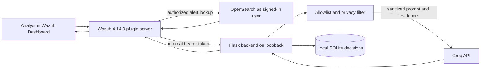

# AI SOC Platform

[](https://github.com/Albinthomas2005/AI-SOC-Platform/actions/workflows/backend-tests.yml)

An educational security operations prototype that connects Wazuh alert review
to a loopback-only Python API and a Groq language model. It helps an analyst
read selected alert evidence and draft investigation notes. It does not
automate containment or replace analyst judgment.

## Problem and approach

Wazuh provides alerts and investigation context, while an analyst may want a
plain-language explanation or a structured report draft. This project adds a
Dashboard plugin and a small backend for that workflow. The backend applies
an alert-field allowlist and privacy filtering before provider calls. A local
analyst decision record can mark generated output approved, edited, or
rejected.

## Architecture



The browser never receives the Groq key or the backend internal token. The
Dashboard server performs the selected-alert lookup as the signed-in user;
the backend independently reapplies its allowlist. Only the Dashboard service
and the backend are expected to use the internal token.

## Repository map

- `backend/`: Flask API, Groq service, privacy filter, SQLite persistence,
  importer, evaluation harness, and unit tests.
- `wazuh-dashboard/`: Wazuh Dashboard source and the Wazuh 4.14.9 plugin in
  `wazuh-dashboard/plugins/main/`.
- `datasets/simulated-alerts/`: synthetic alert examples and 14 evaluation
  scenarios. These are not production telemetry.
- `data/`: instructions and loader input location for a local Enterprise
  ATT&CK catalog. No full catalog is bundled.
- `docs/`: evaluation analysis, privacy explanation, and limitations.
- `documentation/`: architecture, installation, systemd, and historical
  evaluation materials.

## Feature status

| Feature | Status |
|---|---|
| Backend API input validation, allowlisting, and privacy tests | Verified by local unit tests (86 passed in the latest run during this work) |
| Live Groq analysis from this branch | Not yet verified; no provider call was made |
| Wazuh Dashboard plugin build after portfolio changes | Not yet verified; Dashboard dependencies are not installed here |
| AI Alert Analysis in a live Dashboard | Not yet verified in this work session |
| Generate Report end-to-end | Backend behavior is unit tested; Dashboard runtime is not yet verified |
| Analyst approve/edit/reject flow | Backend persistence is unit tested; Dashboard interaction is not yet verified |
| ATT&CK ID validation | Code and mocked tests are present; full local catalog is not yet provided |
| Synthetic evaluation | A historical saved run recorded 8/14 passing before the current response-schema and MITRE changes; rerun before comparing |
| Dashboard artifact installation | Installer checks are implemented; local install has not been run in this work session |

See [the evaluation notes](docs/EVALUATION.md) for the historical failures and
comparison template. Results are not a security certification.

## Local setup

The backend workflow uses Python 3.12. From the repository root:

```bash
cd backend
python3.12 -m venv .venv
source .venv/bin/activate
python -m pip install -r requirements.txt
cp .env.example .env
chmod 600 .env
```

Edit `backend/.env` locally. Set `GROQ_API_KEY` to your own key and generate a
private backend token with:

```bash
python -c 'import secrets; print(secrets.token_urlsafe(32))'
```

Put it in `SOC_AI_INTERNAL_TOKEN` in the backend environment and configure the
same value in the trusted Wazuh Dashboard service environment. Do not paste
either secret into source control, logs, the browser, or this repository.
`backend/.env.example` and the root `.env.example` contain placeholders only.

The backend defaults to `127.0.0.1:5000`. `SOC_AI_HOST` accepts loopback values
by default; non-loopback binding requires `SOC_AI_ALLOW_NON_LOOPBACK=true` and
separate network controls. Do not expose port 5000 to the network.

Start the backend from `backend/`:

```bash
python app.py
```

See [backend setup and API details](backend/README.md) and the
[systemd example](documentation/systemd.md). The service unit has not been
installed by this project workflow.

## Tests and synthetic evaluation

Run the backend unit suite without Wazuh or a live Groq call:

```bash
cd backend
python -m unittest discover -s tests -v
```

The root workflow [`.github/workflows/backend-tests.yml`](.github/workflows/backend-tests.yml)
runs the same command on pushes and pull requests to `main`, with Python 3.12.
The separate plugin build workflow is manually dispatched.

With the backend running and `SOC_AI_INTERNAL_TOKEN` set in `backend/.env`,
run the synthetic evaluation from `backend/`:

```bash
python scripts/run_eval.py --delay 1 --save-responses eval-responses
```

The harness writes its summary to `documentation/evaluation.md`. Saved
response bodies may contain sanitized but identifying context; keep them
local. The `eval-responses/` directory is ignored by Git. No evaluation was
run for the current prompt/schema changes.

## Dashboard plugin build and installation

The source targets Wazuh Dashboard 4.14.9 and OpenSearch Dashboards 2.19.6.
The root workflow `.github/workflows/build-dashboard-plugin.yml` builds in
`quay.io/wazuh/osd-dev:2.19.6` and uploads the `wazuh-plugin-ai-soc` artifact.
It has an optional lint/Jest input. The build and those checks have not been
run after the current UI changes.

On an authorized Ubuntu host with GitHub CLI access, first check the local
installation without downloading an artifact:

```bash
./scripts/install-plugin.sh --check
```

Then provide a successful workflow run ID, or omit it to select the latest
successful run:

```bash
./scripts/install-plugin.sh [RUN_ID]
```

The installer checks Dashboard version compatibility, stages the archive for
the plugin user, backs up the installed plugin before replacing it, prints a
rollback command, and restarts only `wazuh-dashboard`. It may require `sudo`
for the protected system installation. Manual archive extraction is opt-in
only (`MANUAL_INSTALL=1`) when no plugin installer executable is available.
This host install has not yet been verified.

## Privacy and limitations

The filter masks selected email, token, secret, and address patterns. Strict
mode optionally masks common hostnames, URLs, MAC addresses, usernames, and
paths. It does not prove anonymization; allowlisted descriptions and analyst
notes can still contain identifying details and are sent to a third-party AI
provider. Review data handling before using non-synthetic alerts.

AI output may be wrong or incomplete. MITRE output remains unverified until a
local catalog is supplied. A human must review output before using it. The
project does not correlate arbitrary event histories, block hosts, disable
accounts, execute remediation, or replace Wazuh access control.

Read [Privacy](docs/PRIVACY.md) and [Limitations](docs/LIMITATIONS.md) before
connecting production data.

## Roadmap

- Run the Dashboard build and UI tests in the pinned Wazuh development image.
- Load and review a current official Enterprise ATT&CK catalog.
- Re-run the 14 synthetic scenarios and preserve local response evidence for
  failures.
- Verify the full analyst decision flow and report export on a lab Dashboard.
- Review privacy behavior against representative, approved lab records.

## License and attribution

`wazuh-dashboard/` is a fork of Wazuh Dashboard, Copyright Wazuh, Inc.,
distributed under GPL-2.0. The backend is currently treated as GPL-2.0 for
this combined repository; the repository owner should confirm that choice.

<!-- TODO: Owner confirmation of the backend license choice remains pending. -->
