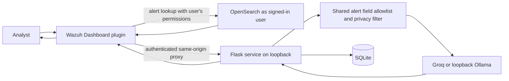

# AI SOC Platform

An educational Wazuh Dashboard extension and local Flask service for reviewing
alerts, grouping related events, and drafting analyst notes. AI output is
unverified until an analyst reviews it. The project does not perform
containment or other automatic remediation.

## Architecture



The browser does not receive the provider API key or backend token. The
Dashboard server reads selected alerts as the signed-in user, then calls the
backend with an internal bearer token. The backend checks the token and applies
its own field allowlist and privacy filtering before building AI prompts.

## Features

| Area | What is in the repository | Verification |
|---|---|---|
| Alert AI Analysis | Shared tab in Threat Hunting, Malware Detection Events, MITRE Events, and the MITRE technique recent-events flyout. | Render tests written; plugin Jest tests not run. |
| Reports | Selected-alert report drafts, safe provider failure reasons, authenticated provider health endpoint, and analyst approve/edit/reject records. | Backend unit tests ran; provider health against live services was not checked. |
| Workbench | Correlation, incidents, threat intelligence, read-only hunting, audit, and evidence assistant panels. | Backend unit tests ran; plugin Jest tests and browser use were not verified. |
| Analyst training | Synthetic scenarios, deterministic grading, and AI coaching routes. | Backend unit tests ran; no live provider call was made. |
| Demo seed | Labeled SSH failures, a sudo-to-root event, and a resolved incident in a separate SQLite file. | Seed tests use temporary databases and ran in the backend suite. |

The SOC Workbench is registered at `/phase-workbench` and in the Wazuh
application list as **SOC Workbench**. It is reachable from the AI SOC
Dashboard's **Workbench** button and the left navigation.

## Setup

The backend requires Python dependencies from `backend/requirements.txt`. The
Dashboard plugin targets Wazuh Dashboard 4.14.9 and OpenSearch Dashboards
2.19.6.

1. Create the local environment file and replace its placeholders. Keep the
   resulting file private and untracked.

   ```bash
   cp backend/.env.example backend/.env
   chmod 600 backend/.env
   ```

   Set `GROQ_API_KEY` for Groq, or choose Ollama with
   `SOC_AI_PROVIDER=ollama` and a loopback `OLLAMA_BASE_URL`. Generate a
   `SOC_AI_INTERNAL_TOKEN` and configure the same value in the trusted
   Dashboard server environment.

2. Start the local backend from the repository root. The script pins the
   backend host to loopback.

   ```bash
   ./scripts/run-backend.sh
   ```

   Set `SOC_AI_PORT` in the shell before starting the script to use a port
   other than 5000.

3. Build the plugin in the pinned Wazuh dependency environment.

   ```bash
   cd wazuh-dashboard/plugins/main
   OPENSEARCH_DASHBOARDS_VERSION=2.19.6 yarn build
   ```

   `scripts/install-plugin.sh` installs a successful workflow artifact on an
   authorized Dashboard host. It may need `sudo` to access the installation
   and restarts the Dashboard service; those host actions have not been run
   here.

## Usage: SSH brute-force demo

1. Seed the dedicated demo database. The script refuses the normal
   `backend/soc_alerts.db` path and requires `demo` in the target filename.

   ```bash
   PYTHON_DOTENV_DISABLED=1 backend/.venv/bin/python scripts/seed-demo.py
   ```

   It creates three `[DEMO]` SSH failures from the documentation-only address
   `203.0.113.50`, one `[DEMO]` sudo-to-root record, and one resolved `[DEMO]`
   incident. Use `--reset` to replace only those fixtures.

2. Start the backend against that database by setting its path before Python
   imports the application:

   ```bash
   SOC_AI_DB_PATH="$PWD/backend/soc_alerts-demo.db" ./scripts/run-backend.sh
   ```

3. In the Wazuh Dashboard, open **SOC Workbench** from the left menu or the
   **Workbench** button. The incident panel reads its incident list from the
   backend database. Correlation and threat-intel panels resolve alert
   references in OpenSearch as the signed-in user; the SQLite seed does not
   populate OpenSearch. To use those panels, the equivalent synthetic events
   must also be present in an authorized Wazuh alert index.

The seed can be checked locally with the tests in
`backend/tests/test_seed_demo.py`; it does not read the real database.

## Security and privacy design

- The backend uses bearer-token authentication. Dashboard routes use a
  same-origin proxy and look up alerts as the current Dashboard user.
- One shared allowlist selects `timestamp`, rule identifiers and descriptions,
  rule groups and MITRE metadata, `agent.name`, selected source/destination
  user fields, `data.srcip`, and `location`. Raw `full_log`, other host fields,
  and unlisted alert data are excluded from AI evidence.
- Address and sensitive-text patterns are filtered before AI prompts. Threat
  intelligence only extracts IOCs from allowlisted alert fields and excludes
  private IPs before external provider lookups. Pattern filtering is not a
  guarantee of anonymity; review data handling before using real alerts.
- Provider errors are translated into a short safe reason and logged with a
  request ID. The authenticated `/api/ai/health` endpoint reports provider
  configuration and reachability; no live health request was made here.
- Role checks gate sensitive routes. Retention operations default to dry-run;
  actual purge is admin-only. SQLite stores alert/report and analyst workflow
  records locally.

## Testing

The backend suite was run from the repository root with:

```bash
PYTHON_DOTENV_DISABLED=1 backend/.venv/bin/python -m unittest discover backend
```

That run completed **171 tests successfully**. Tests use temporary databases
and mocked providers. Dashboard plugin Jest tests have not run: `yarn` was not
available in this environment. The plugin build, browser behavior, screenshots,
Wazuh/OpenSearch integration, and live Groq/Ollama calls have not been verified.

## Limitations and future work

- The UI requires a compatible running Wazuh Dashboard and authorized
  OpenSearch data. Demo SQLite records alone do not create OpenSearch alerts.
- AI-generated content can be wrong, incomplete, or influenced by untrusted
  alert text. Analysts must verify it against source evidence.
- The demo IP is reserved for documentation and is not routable evidence.
- No live provider, Dashboard host install, plugin Jest suite, plugin build,
  screenshots, or browser workflow was verified in this work.
- Review generated training answer keys before treating them as grading truth.
- Continue with a pinned-environment plugin test/build, browser review against
  a lab Dashboard, and an operator-approved retention and deployment review.

## Repository hygiene and modified Wazuh files

Root and backend ignore rules cover `.env`, `*.db`, logs, backups, and
`node_modules`. A local history scan for common Groq, GitHub, AWS, and private
key signatures found no matches. This limited signature scan cannot establish
that all possible secrets are absent; history was not rewritten. The current
untracked audit file and `scripts/ci-loop.sh` were left untouched and unstaged.

Wazuh app files modified on this branch:

- `public/app-router.tsx`, `public/plugin.ts`, `public/types.ts`,
  `public/utils/applications.ts`.
- `public/components/ai-soc-dashboard/index.tsx`, `index.test.tsx`,
  `route.tsx`, `route.test.tsx`.
- `public/components/common/wazuh-discover/wz-discover.tsx` and
  `components/ai-analysis-tab.tsx`, `components/ai-analysis-tab.test.tsx`,
  `components/ai-analysis-tabs.tsx`, `components/ai-analysis-tabs.test.tsx`.
- `public/components/overview/mitre/framework/components/techniques/components/flyout-technique/technique-row-details.tsx`.
- `public/components/phase-workbench/index.tsx`, `index.test.tsx`, and
  `public/components/discover-ai-analyst/index.tsx`, `index.test.tsx`.
- `server/controllers/index.ts`, `wazuh-ai.ts`, `wazuh-hunting.ts`,
  `wazuh-phase.ts`; and `server/routes/index.ts`, `wazuh-ai-report.test.ts`,
  `wazuh-hunting.ts`, `wazuh-hunting.test.ts`, `wazuh-phase.ts`.

The Wazuh plugin Jest tests have not run. No push was made.
