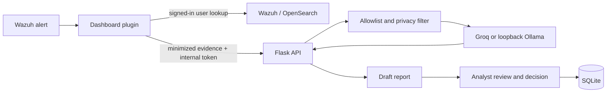

# AI SOC Platform

AI-assisted SOC alert triage on Wazuh: privacy-filtered, analyst-approved, and built for training SOC analysts.

## The problem

SOC analysts face alert overload, repetitive triage and report writing, while new analysts often lack realistic practice. Sending raw security logs to an external AI provider can expose personal or operational data.

## The solution

This project connects a Wazuh Dashboard plugin to a local Flask service. It filters and minimizes evidence before AI provider calls, creates editable report drafts, and stores analyst decisions. A separate training workflow uses synthetic scenarios. The design principle is: **AI drafts, the analyst decides.**

## How it works

1. An analyst opens a Wazuh alert in the plugin; the Dashboard server retrieves it as the signed-in Wazuh user.
2. The server sends minimized evidence to the loopback Flask API using an internal bearer token.
3. The backend applies its allowlist and privacy filter before the configured AI provider receives a prompt.
4. The AI response is returned as a draft for analyst review and editing.
5. The analyst approves, edits, or rejects the draft; the decision and sanitized evidence are stored in SQLite.



## What makes it different

- **Privacy filtering before AI calls:** code handles IPv4/IPv6 candidates, percent-encoded addresses, email addresses, bearer tokens, and labeled secrets. Structured fields with names containing `private_key` are redacted. IPs are pseudonymized within one provider request to preserve correlation. The filter does not detect arbitrary PEM private-key blocks in free text; it is pattern-based and is not complete anonymization.
- **Human review:** analysis decisions (`approved`, `edited`, `rejected`) and optional notes are stored with the original draft.
- **Role checks:** backend routes enforce L1/L2/L3/admin minimum roles. Dashboard identity must be mapped to a provisioned SOC username.
- **Local AI option:** the Ollama adapter accepts localhost or loopback URLs; the default provider is Groq.
- **Training mode:** synthetic scenarios, attempts, coaching, and training shifts are implemented. Scenarios and answer keys are drafts for human review. A bundled MITRE ATT&CK catalog contains 706 techniques.

## Features

| Area | Implemented behavior |
|---|---|
| Wazuh integration | Plugin retrieves selected alerts using the signed-in Dashboard user |
| AI triage and reports | Groq default, optional loopback Ollama; generated report drafts |
| Privacy | Alert-field allowlists and provider-boundary filtering/pseudonymization |
| Review workflow | Edit, approve, or reject; decisions persisted in SQLite |
| Analyst workflow | Roles, audit events, incidents, shift handover, and read-only hunt proposals |
| Training | Synthetic scenarios, grading/coaching, progress, shifts, local ATT&CK catalog |
| Tests and CI | Python tests and GitHub Actions backend workflow |

## Architecture and stack

Python 3, Flask, SQLite, Groq Python client, TypeScript/React Wazuh Dashboard plugin, and GitHub Actions. See [Architecture](docs/ARCHITECTURE.md), [Roles and users](docs/ROLES_AND_USERS.md), and [Threat model](docs/THREAT_MODEL.md).

## Skills demonstrated

SIEM integration, secure AI integration, Python/Flask API design, TypeScript plugin development, SQLite persistence, automated testing, CI, privacy engineering, and threat modeling.

## Project status

| Status | Scope |
|---|---|
| Implemented in code | Wazuh integration; Groq default and optional Ollama; privacy filtering; reports with edit/approve/reject decisions; shift handover; training mode (scenario/answer-key content remains draft); local catalog of 706 ATT&CK techniques |
| Removed | AI SOC Dashboard page and Upload logs page |
| Pending verification | Live Dashboard verification; end-to-end test; `/api/hunts/run` 500 report; `403` on incidents/audit until the Dashboard username is mapped to a `soc_users` role |
| Planned | Event correlation improvements and threat intelligence workflow |
| Not established | Production readiness |

The AI SOC Dashboard and Upload logs pages were removed in commit `73d2062`. This repository has not been verified on a live Dashboard installation. `POST /api/hunts/run` is a Dashboard plugin endpoint; its reported 500 has not been verified in a live installation. Flask tests establish that this is not a Flask POST route. Incidents and audit requests require an explicitly provisioned SOC role for the mapped Dashboard user. See [roles and users](docs/ROLES_AND_USERS.md).

## Setup

Requirements: Python 3.10+ and pip. AI analysis requires a Groq key, or configure an already-running local Ollama model. Dashboard integration requires a compatible Wazuh Dashboard installation and its normal Wazuh/OpenSearch authentication setup.

```bash
python3 -m venv backend/.venv
backend/.venv/bin/python -m pip install -r backend/requirements.txt
cp backend/.env.example backend/.env
```

Set `GROQ_API_KEY` and a strong `SOC_AI_INTERNAL_TOKEN` in the ignored `backend/.env`. To use Ollama, set `SOC_AI_PROVIDER=ollama`, `OLLAMA_BASE_URL=http://127.0.0.1:11434`, and `OLLAMA_MODEL` to an installed model. Do not expose the backend beyond loopback without separately configuring and reviewing network controls. The backend starts with:

```bash
cd backend
.venv/bin/python app.py
```

The setup and server-start commands above were not run during this repository review; a configured Wazuh deployment and AI provider are not verified here.

Configure the Dashboard plugin's server environment with the same internal token and backend settings. Map only explicitly provisioned Dashboard identities with `SOC_AI_USERNAME_MAP`; details are in [docs/ROLES_AND_USERS.md](docs/ROLES_AND_USERS.md). No SOC user or default administrator is created by this documentation or setup.

## Tests

From the repository root:

```bash
backend/.venv/bin/python -m pytest backend/tests
```

Latest run in this checkout: **176 passed in 2.58s** (Python 3.14.4, pytest 9.2.0). Setup and live server commands above were not run. The test result does not establish live Dashboard or provider behavior.

## Roadmap

- Verify the plugin on a live compatible Dashboard and complete the end-to-end workflow.
- Investigate the reported hunt route failure and validate role mapping in a configured deployment.
- Review training scenarios and answer keys with SOC practitioners.
- Develop event correlation and threat intelligence workflows.
- Establish operational controls and evidence before making production-readiness claims.

## Security

See [SECURITY.md](SECURITY.md) and [docs/THREAT_MODEL.md](docs/THREAT_MODEL.md). Never commit `.env` files, real credentials, logs, or databases. Privacy filtering reduces exposure but cannot guarantee anonymization. AI output and ATT&CK suggestions require analyst verification.

## Author

Albin Thomas
