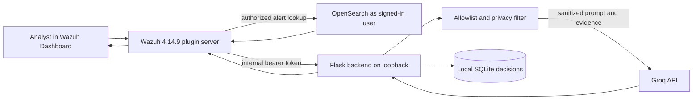

# AI SOC Platform

[](https://github.com/Albinthomas2005/AI-SOC-Platform/actions/workflows/backend-tests.yml)

An educational security operations prototype that connects Wazuh alert review
to a loopback-only Python API and a Groq language model. It helps an analyst
read selected alert evidence and draft investigation notes. It does not
automate containment or replace analyst judgment.

## Quick start

1. Start the local backend from the repository root (requires
   `backend/.venv` and its local configuration):

   ```bash
   ./scripts/run-backend.sh
   ```

2. In another terminal, run the backend suite:

   ```bash
   source backend/.venv/bin/activate
   python -m unittest discover backend
   ```

3. Set `SOC_AI_INTERNAL_TOKEN` in your shell from your protected local
   configuration, then check the training endpoints:

   ```bash
   ./scripts/smoke-test.sh
   ```

4. Build the Dashboard plugin in its pinned dependency environment, then
   install a successful workflow artifact on the target host:

   ```bash
   cd wazuh-dashboard/plugins/main
   OPENSEARCH_DASHBOARDS_VERSION=2.19.6 yarn build
   cd ../../..
   ./scripts/install-plugin.sh RUN_ID
   ```

   The installer requires a successful artifact workflow run ID and access to
   the target Dashboard installation; see its usage before installing.

## Problem and approach

Wazuh provides alerts and investigation context, while an analyst may want a
plain-language explanation or a structured report draft. This project adds a
Dashboard plugin and a small backend for that workflow. The backend applies
an alert-field allowlist and privacy filtering before provider calls. A local
analyst decision record can mark generated output approved, edited, or
rejected.

## Architecture



The browser never receives the Groq key or the backend internal token. The
Dashboard server performs the selected-alert lookup as the signed-in user;
the backend independently reapplies its allowlist. Only the Dashboard service
and the backend are expected to use the internal token. The provider defaults
to Groq; an optional Ollama adapter accepts only a localhost or loopback URL.

## Repository map

- `backend/`: Flask API, Groq service, privacy filter, SQLite persistence,
  importer, evaluation harness, and unit tests.
- `wazuh-dashboard/`: Wazuh Dashboard source and the Wazuh 4.14.9 plugin in
  `wazuh-dashboard/plugins/main/`.
- `datasets/simulated-alerts/`: synthetic alert examples and 14 evaluation
  scenarios. These are not production telemetry.
- `datasets/training/`: analyst-visible scenarios and a separate server-only
  answer-key file.
- `data/`: generated local Enterprise ATT&CK catalog and build instructions;
  the raw STIX source is kept locally under ignored `data/raw/`.
- `docs/`: evaluation analysis, privacy explanation, and limitations.
- `documentation/`: architecture, installation, systemd, and historical
  evaluation materials.

## Project status

| Phase | Status |
|---|---|
| 1: backend analysis, report review/decisions, training, shifts, port configuration | Implemented, unverified in browser |
| 4: deterministic correlation API and timeline | Implemented, unverified in browser |
| 5: incident API, validated status transitions, evidence, notes and reports | Implemented, unverified in browser |
| 6: public IOC extraction, privacy filtering, provider adapters, cache and limits | Implemented, unverified in browser; live providers not checked |
| 7: validated read-only hunting workflow | Implemented, unverified in browser |
| 9: role-scoped evidence assistant | Implemented, unverified in browser |
| 10a: role enforcement and append-only audit | Implemented, unverified in browser |
| 10b: dry-run retention and request/rate limits | Implemented, unverified in browser |
| Plugin workbench for correlation, incidents, intel, hunting, audit and assistant | Implemented, unverified in browser; plugin tests written, not run |
| Evaluation CLI | Implemented with mocked tests; live evaluation not run |

Pending: browser test, Dashboard plugin build, screenshots, analyst review of
the 16 **DRAFT** answer keys, evaluation rerun/live evaluation, event-correlation
browser review, production data retention/load test, and production readiness.
The backend suite has passed **162 tests** in the latest audited-branch run; the smoke
script, browser UI, plugin build, live provider behavior, and live evaluation
have not been run for this workbench update.

## Training Mode

Training Mode provides a scenario queue, alert and evidence views, deterministic
grading, free hints, report completeness feedback, and structured AI report
coaching. After submission, the analyst can compare their verdict and MITRE
choices with the AI assessment and expected answer. Progress includes accuracy,
common mistakes, review reminders, and exportable reports. Timed shifts use
eight mixed cases, a 20-minute timer, no hints, separate shift storage, and an
AI-coached handover note. The 16 new answer keys are **DRAFTS pending analyst
review**; do not treat them as trusted ground truth until reviewed.

### Setup and run

Follow [Local setup](#local-setup) to create and activate `backend/.venv`,
install requirements, and configure the backend environment. The backend reads
scenario data from `datasets/training/` and the local ATT&CK catalog from
`data/mitre_techniques.json`. Start it from `backend/`:

```bash
source .venv/bin/activate
python app.py
```

The Training page is part of the Wazuh Dashboard plugin at
`wazuh-dashboard/plugins/main/`. With the pinned Dashboard dependencies
installed, build from that directory:

```bash
OPENSEARCH_DASHBOARDS_VERSION=2.19.6 yarn build
```

### Tests

Run the backend suite from the repository root with the backend virtual
environment active. Tests use temporary SQLite databases and mocked AI
providers; they do not require live alert data or a provider key:

```bash
source backend/.venv/bin/activate
python -m unittest discover backend
```

The TypeScript and plugin build require the pinned Wazuh Dashboard dependency
environment; see the plugin build instructions above.

### Screenshots

Screenshot placeholders (images are not included yet):

- Scenario queue: `docs/screenshots/scenario-queue.png`
- Evidence view: `docs/screenshots/evidence-view.png`
- Score breakdown: `docs/screenshots/score-breakdown.png`
- Analyst vs AI vs expected: `docs/screenshots/analyst-ai-expected.png`
- Timed shift: `docs/screenshots/shift.png`

See [Training Mode documentation](docs/TRAINING_MODE.md) for the scenario
format, key separation, scoring rules, and limitations. See
[`docs/ANSWER_KEY_REVIEW.md`](docs/ANSWER_KEY_REVIEW.md) for the generated
review checklist covering all 16 draft keys.

## Local setup

The backend workflow uses Python 3.12. From the repository root:

```bash
cd backend
python3.12 -m venv .venv
source .venv/bin/activate
python -m pip install -r requirements.txt
cp .env.example .env
chmod 600 .env
```

Edit `backend/.env` locally. Set `GROQ_API_KEY` to your own key and generate a
private backend token with:

```bash
python -c 'import secrets; print(secrets.token_urlsafe(32))'
```

Put it in `SOC_AI_INTERNAL_TOKEN` in the backend environment and configure the
same value in the trusted Wazuh Dashboard service environment. Do not paste
either secret into source control, logs, the browser, or this repository.
`backend/.env.example` and the root `.env.example` contain placeholders only.

The backend defaults to `127.0.0.1:5000`. `SOC_AI_PORT` sets the port used by
the Flask service, Dashboard server, scripts, and evaluator. `SOC_AI_HOST` accepts
loopback values by default; non-loopback binding requires
`SOC_AI_ALLOW_NON_LOOPBACK=true` and separate network controls. Do not expose
the backend port to the network.

`SOC_AI_DB_PATH` optionally selects a different SQLite database and is read
when each database connection is opened, including after `.env` is loaded.

Start the backend from `backend/`:

```bash
python app.py
```

See [backend setup and API details](backend/README.md) and the
[systemd example](documentation/systemd.md). The service unit has not been
installed by this project workflow.

## Tests and synthetic evaluation

Run the backend unit suite without Wazuh or a live Groq call:

```bash
cd backend
python -m unittest discover -s tests -v
```

The root workflow [`.github/workflows/backend-tests.yml`](.github/workflows/backend-tests.yml)
runs the same command on pushes and pull requests to `main`, with Python 3.12.
The separate plugin build workflow is manually dispatched.

With the backend running and `GROQ_API_KEY` plus `SOC_AI_INTERNAL_TOKEN`
exported in its process environment, run the synthetic evaluation from `backend/`:

```bash
python scripts/run_eval.py --delay 1 --save-responses eval-responses
```

The harness writes its summary to `docs/EVALUATION_RESULTS.md`. Saved
response bodies may contain sanitized but identifying context; keep them
local. The `eval-responses/` directory is ignored by Git. The live evaluation
was not run for this stabilization task.

## Dashboard plugin build and installation

The source targets Wazuh Dashboard 4.14.9 and OpenSearch Dashboards 2.19.6.
The root workflow `.github/workflows/build-dashboard-plugin.yml` builds in
`quay.io/wazuh/osd-dev:2.19.6` and uploads the `wazuh-plugin-ai-soc` artifact.
It has an optional lint/Jest input. The build and those checks have not been
run after the current UI changes.

On an authorized Ubuntu host with GitHub CLI access, first check the local
installation without downloading an artifact:

```bash
./scripts/install-plugin.sh --check
```

Then provide a successful workflow run ID, or omit it to select the latest
successful run:

```bash
./scripts/install-plugin.sh [RUN_ID]
```

The installer checks Dashboard version compatibility, stages the archive for
the plugin user, backs up the installed plugin before replacing it, prints a
rollback command, and restarts only `wazuh-dashboard`. It may require `sudo`
for the protected system installation. Manual archive extraction is opt-in
only (`MANUAL_INSTALL=1`) when no plugin installer executable is available.
This host install has not yet been verified.

## Privacy and limitations

The provider boundary masks selected email, token, secret, address, hostname,
URL, MAC, username, and path patterns. This does not prove anonymization;
allowlisted descriptions and analyst notes can still contain identifying
details and are sent to a third-party AI provider. Review data handling before
using non-synthetic alerts.

AI output may be wrong or incomplete. The local ATT&CK catalog checks whether
technique IDs exist; it does not establish that an AI mapping fits the evidence.
A human must review output before using it. The project does not correlate
arbitrary event histories, block hosts, disable accounts, execute remediation,
or replace Wazuh access control.

Read [Privacy](docs/PRIVACY.md) and [Limitations](docs/LIMITATIONS.md) before
connecting production data.

For a local model, configure `SOC_AI_PROVIDER=ollama` and set `OLLAMA_MODEL`
to a model already installed in Ollama. See the provider settings in
[`backend/README.md`](backend/README.md). The adapter has mocked tests; a live
Ollama installation has not yet been verified.

## Roadmap

- Run the Dashboard build and UI tests in the pinned Wazuh development image.
- Load and review a current official Enterprise ATT&CK catalog.
- Re-run the 14 synthetic scenarios and preserve local response evidence for
  failures.
- Verify the full analyst decision flow and report export on a lab Dashboard.
- Review privacy behavior against representative, approved lab records.

## License and attribution

`wazuh-dashboard/` is a fork of Wazuh Dashboard, Copyright Wazuh, Inc.,
distributed under GPL-2.0. The backend is currently treated as GPL-2.0 for
this combined repository; the repository owner should confirm that choice.

<!-- TODO: Owner confirmation of the backend license choice remains pending. -->
