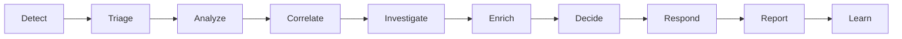

# Architecture and analyst workflow

The intended path through the implemented modules is:

| Step | Real implementation | Route or entry point |
|---|---|---|
| Detect | Wazuh creates alert documents in OpenSearch. The plugin reads selected alerts using the current user's OpenSearch permissions. | Wazuh alert index; plugin `WazuhPhaseCtrl.selectedAlerts` |
| Triage | Training scenarios, evidence, grading and timed shifts. | `/training/scenarios`, `/training/progress`, `/training/shifts`; `backend/training.py` |
| Analyze | Privacy-filtered alert analysis and report drafts, with analyst decisions persisted in SQLite. | `/api/ai/analyze-alert`, `/api/ai/generate-report`, `/api/ai/analysis/<id>/decision`; `backend/app.py` |
| Correlate | Deterministic grouping by shared host, user or source IP in the configured time window; generated timeline retains alert and rule IDs. | `POST /api/correlations`; `backend/correlation.py` |
| Investigate | Incident evidence, status changes, assignment, notes, decisions, timeline and Markdown report. | `/api/incidents`; `backend/incidents.py` |
| Enrich | Public IOC extraction, private-address/internal-host filtering, cached VirusTotal and AbuseIPDB lookups. | `POST /api/threat-intel/lookup`; `backend/threat_intel.py` |
| Decide | Analyst review decisions and incident decision records; events are appended to the audit log. | `/api/ai/analysis/<id>/decision`, `/api/incidents/<id>/decisions`; `backend/roles_audit.py` |
| Respond | Incident state progression records containment and resolution decisions. The prototype does not execute containment in Wazuh. | `/api/incidents/<id>/status`; `backend/incidents.py` |
| Report | Report generation, incident Markdown export, and stored hunting reports. | `/api/ai/generate-report`, `/api/incidents/<id>/report`, `/api/hunts/<id>` |
| Learn | Training attempts, hints, progress, coaching and handover feedback. | `/training/*`; `backend/training.py` |

Cross-cutting controls are in `backend/roles_audit.py` (role enforcement and
append-only audit), `backend/privacy.py` (provider-bound text filtering),
`backend/retention.py` (dry-run-by-default purge), and `backend/rate_limit.py`.
The plugin's phase routes in `wazuh-dashboard/plugins/main/server/routes/`
authenticate the Dashboard user, forward that identity to the backend, and
perform selected-alert reads as the signed-in OpenSearch user. Provider use
remains server-side. The UI is implemented but has not been verified in a
browser; see the project status in the root README.
