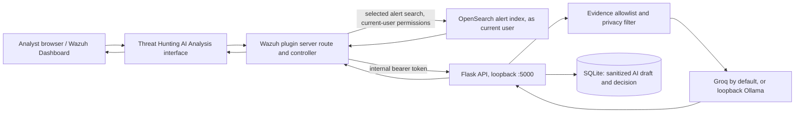

# AI SOC Platform — Complete Technical Audit

**Audit date:** 2026-11-07  
**Scope:** Read-only inspection of this checkout’s documentation, Python backend, SOC-specific Wazuh Dashboard plugin code, configuration examples, workflows, and test source. No network/provider calls, services, database queries, test execution, builds, installs, or source changes were performed.  
**Git state observed:** one pre-existing untracked file, `scripts/ci-loop.sh`; it was left untouched.  
**Secret handling:** `backend/.env` exists but was not opened. Only variable names and placeholder examples were inspected. The existing SQLite database and build archives were not opened.

## 1. Executive summary

This is an educational analyst-assistance prototype integrated into a Wazuh Dashboard fork. Its strongest end-to-end capability is a selected-alert investigation report: the Dashboard server re-reads the chosen alert as the signed-in OpenSearch user, applies an explicit field allowlist, sends minimized evidence through a loopback Flask API using an internal bearer token, sanitizes provider-bound prompts, and asks Groq by default (or optional local Ollama) for a clearly unverified draft. The dashboard can display, edit, approve, or reject that report; decisions are stored in local SQLite.

There is also a single-alert analysis API with structured response checks and MITRE-reference validation, but its Dashboard controller does not return the backend analysis ID or decision metadata. Thus the reviewable report path is more complete than the analysis path. Existing native Wazuh Threat Hunting, alert search, vulnerability views, and dashboards are Wazuh product capabilities; they are not new platform implementations.

The project does not provide cross-event correlation, case lifecycle management, automated response, enriched threat intelligence, autonomous investigation, or a mature evidence repository. Its separate JSONL importer and direct OpenSearch writer represent earlier/parallel experiments, not the active dashboard-to-AI path. The source is substantial and has focused mocked/unit tests, but no runtime validation was carried out here. Production readiness is **not established**.

## 2. Purpose and objectives

The repository describes itself as an educational SOC home-lab prototype. It aims to help a human analyst interpret a selected Wazuh alert, see cautious evidence-grounded guidance, draft a report, and record an analyst decision. It is decision support for L1/L2/L3 staff, not an autonomous SOC or replacement for analyst judgment.

- **L1:** can use alert summaries and a report draft as an orientation aid; no guided triage queue, validated disposition workflow, or handoff controls exist.
- **L2:** can manually inspect alert details in Wazuh and use generated investigation steps; no related-event search/correlation is included in the report flow.
- **L3:** can inspect raw implementation and improve prompts/providers, but there is no rule engineering, detection tuning workflow, threat-intel case graph, or governed model evaluation system in the app.

These are capability interpretations from source, not claims of role-specific authorization. No explicit RBAC policy for analyst tiers is implemented.

## 3. Directory structure and project inventory

Top-level structure (the Wazuh fork has a much larger upstream tree; this map highlights the functional project areas):

```text
.
├── README.md, LICENSE, .env.example
├── backend/
│   ├── app.py, database.py, groq_service.py, ai_providers.py
│   ├── privacy_filter.py, mitre_validation.py
│   ├── wazuh_importer.py, wazuh_groq_integration.py
│   ├── requirements.txt, .env.example, README.md
│   ├── scripts/ (smoke test, evaluation, ATT&CK converter)
│   ├── tests/ (8 Python test modules)
│   ├── eval-responses/ (saved synthetic response fixtures)
│   └── soc_alerts.db, .venv/, __pycache__/ (existing local artifacts)
├── wazuh-dashboard/
│   ├── plugins/main/ (Wazuh Dashboard 4.14.9 plugin source and upstream UI)
│   │   ├── public/app-router.tsx, public/utils/applications.ts
│   │   ├── server/controllers/wazuh-ai.ts
│   │   ├── server/routes/wazuh-ai.ts and AI route/controller tests
│   │   └── package.json, yarn.lock, Jest/Cypress test infrastructure
│   ├── plugins/wazuh-core/, docker/, scripts/, docs/, screenshots/
│   └── upstream Wazuh Dashboard source/documentation
├── datasets/simulated-alerts/ (example alert and scenarios)
├── data/ (ATT&CK catalog instructions; full catalog absent)
├── docs/ (status, limitations, privacy, evaluation)
├── documentation/ (architecture, setup, systemd, evaluations, roadmap)
├── scripts/ (plugin installer and detection check; ci-loop.sh untracked)
└── dist/ (existing plugin archive/build-run artifacts)
```

The repository includes a vendored/forked Dashboard codebase, so the majority of files are upstream Dashboard functionality rather than SOC-specific code. `backend/.env` is present and ignored by convention; it was not read. `backend/soc_alerts.db`, archived plugin zips, local Python bytecode/environment, and the untracked CI helper were preserved.

## 4. System architecture and data flow



For reports, browser sends only index, document ID, and optional analyst notes to the plugin route. The server re-reads the document as the current user; it does not trust browser-supplied evidence. The backend then allowlists evidence again, sanitizes notes/evidence at the provider boundary, generates the report, and persists it. The decision proxy sends analyst decisions back to the backend. The analysis endpoint is parallel but its UI/proxy response contract is incomplete for decisions.

Separate workflows exist: `wazuh_importer.py` reads a configured JSONL file and stores rows in the local SQLite `alerts` table; `wazuh_groq_integration.py` can sanitize a supplied JSON alert, call the AI, and write a result to a hard-coded local HTTPS OpenSearch endpoint with a password file and CA certificate. These are not the active Dashboard integration path and have configuration/readiness gaps.

## 5. Technology stack and configuration

- Backend: Python, Flask 3.x, Groq Python SDK 0.x, python-dotenv, standard-library SQLite/urllib/ipaddress/HMAC.
- Dashboard: Wazuh Dashboard plugin 4.14.9 targeting OpenSearch Dashboards 2.19.6, TypeScript/React, Elastic EUI, `needle`; locked Yarn dependencies.
- Storage: local SQLite file `backend/soc_alerts.db`; alert source of truth for the active path is OpenSearch/Wazuh indices.
- CI: GitHub Actions backend unittest workflow; manual plugin archive build workflow with optional lint/Jest checks.
- Environment names found in examples/source: `GROQ_API_KEY`, `GROQ_MODEL`, `SOC_AI_INTERNAL_TOKEN`, `SOC_AI_PROVIDER`, `OLLAMA_BASE_URL`, `OLLAMA_MODEL`, `SOC_AI_HOST`, `SOC_AI_PORT`, `SOC_AI_ALLOW_NON_LOOPBACK`, `SOC_AI_STRICT_PRIVACY`, `WAZUH_ALERTS_FILE`. No values from the private environment file were inspected.
- The active controller hardcodes `http://127.0.0.1:5000`; changing `SOC_AI_PORT` alone will break integration unless the controller is changed in step.

## 6. Backend architecture

- `backend/app.py`: three token-protected routes, request size checks, JSON validation, error mapping, Flask runner configuration, DB initialization on import.
- `backend/groq_service.py`: prompt construction, provider selection, low-temperature generation, analysis output validation, report generation and report structure checks, MITRE validation.
- `backend/ai_providers.py`: Groq adapter and Ollama `/api/chat` adapter with loopback URL restriction and 120-second request timeout.
- `backend/privacy_filter.py`: evidence-field minimization and configurable text/address masking. Per-request HMAC pseudonyms correlate non-public IPs only within one analysis.
- `backend/database.py`: SQLite schema initialization and parameterized data operations; schema includes `alerts`, `wazuh_imports`, `wazuh_raw_alerts`, `ai_analyses`.
- `backend/wazuh_importer.py`: optional JSONL file importer; maps Wazuh rule levels into Low/Medium/High and stores source IP and simple alert summary.
- `backend/wazuh_groq_integration.py`: standalone legacy-style integration and OpenSearch writer.
- `backend/mitre_validation.py`: validates generated ATT&CK IDs against `data/mitre_techniques.json`; absent catalog means IDs are marked unverified.

Most DB queries use bound parameters. The importer performs integer conversion on untrusted `rule.level` without handling malformed values, so a bad row can abort import. It also only rejects world-writable files, not other risky ownership/mode situations.

## 7. Frontend architecture and real behavior

The report workflow supports an optional analyst note, generates an unverified report for a selected alert through the shared Threat Hunting AI Analysis interface, allows editing/approval/rejection with optional note, and persists the decision. The generated evidence itself is included in the backend response; the interface displays the generated report text rather than a clearly separate evidence panel.

No current page implements analyst queue assignment, persistent alert status changes, case view, alert bulk actions, paging beyond five recent records, refresh controls, report retrieval/history, or export. README mentions browser Markdown export in the setup/API discussion, but the inspected component contains no export control. A UI button linking to native Threat Hunting is navigation, not an AI hunting implementation.

## 8. Wazuh integration

### Implemented

- Wazuh Dashboard/OpenSearch integration is actual and selected-alert retrieval is from the configured alert index, not a mock source, in the SOC dashboard/controller code.
- User authentication is checked through `context.wazuh.security.getCurrentUser`; selected records are fetched with `asCurrentUser.search`, respecting the logged-in user’s OpenSearch permissions (and documented DLS/FLS behavior).
- Configured index pattern matching, ID length checks, `_source` allowlist, response-size limits, backend token proxy, upstream timeout/error mapping are present.
- Dashboard recent-alert counts use OpenSearch aggregations over 24 hours; they are not sourced from the SQLite importer.

### Not implemented / not verified

- No Wazuh Manager REST API client or its credential authentication exists in the active path. No Wazuh Indexer API client exists; Dashboard’s OpenSearch client is used.
- No live Wazuh endpoint was contacted in this audit. Refresh is tied to hook/page loading; no timed auto-refresh was found.
- Active report controller is configured to port 5000 regardless of backend bind setting.
- There is no Wazuh-driven incident/case status writeback or containment integration.

### Workflow status

Wazuh/OpenSearch → Dashboard query → signed-in user authorization → server-side minimized selected record → token-authenticated local Flask API → evidence/privacy controls → model → response validation and local record persistence → Dashboard report/decision UI. Source is present; full live operation remains unverified.

## 9. AI integration and reliability

Groq is the default provider, configured by `GROQ_API_KEY` and `GROQ_MODEL` (default model string in source is `openai/gpt-oss-20b`). Ollama is optional, with loopback-only URL enforcement and model selection. There is no live provider call in this audit. Request temperature is 0.2; Groq completion cap is 1024 tokens, and reasoning options are applied to `gpt-oss` model names. Ollama timeout is 120 seconds; Dashboard proxy timeout is 45 seconds, so a slow local provider may outlast the plugin request timeout.

The single-alert analysis prompt requests facts/hypotheses separation, an exact evidence field list, qualitative confidence, unknowns, safe steps, and cautious MITRE mapping. The response validator requires a real alert field path, low/medium/high confidence, and a non-empty unknowns line. Report generation requires three headings, injects deterministic allowlisted evidence separately, marks draft unverified, and validates/removes/marks ATT&CK IDs. It does not ground claims to a structured claim/evidence schema or independently verify semantic correctness. The model can still produce unsupported claims or satisfy format checks while being wrong.

Prompt-injection defenses are instructions to treat supplied logs/notes as untrusted. This is useful mitigation, not a hard isolation boundary. No explicit analyst approval gates provider execution; approval records the resulting report after generation. No confidence calibration/evaluation from real SOC incidents or token-usage accounting is present. The Groq SDK call has no visible retry/backoff policy. Errors return generic API messages; model response contract failures are mapped to 502 for the analyze endpoint; report generation catches generic failure and returns a safe 500.

Privacy controls mask email, credential-like text, selected IP forms, and optionally hostnames/URLs/MAC/usernames/paths in strict mode. Default strict mode is off. The report API allowlists known fields and notes, but descriptions/groups and analyst notes may contain identifiers or malicious instructions. IP masking is not anonymization, and non-IP context can re-identify a host.

## 10. Threat Hunting analysis

Wazuh's native Threat Hunting app is used as the destination for “Investigate alerts.” The AI platform does not implement hunts, query templates, multi-event searches, hypothesis tracking, pivoting, indicator enrichment, or saved hunt results. The 14 synthetic scenarios in `datasets/simulated-alerts/scenarios.json` are evaluation fixtures, not a live hunting engine. Mark feature status as **UI navigation to existing Wazuh functionality**, not AI Threat Hunting implemented.

## 11. SOC feature matrix

| SOC activity | Status | Evidence / actual behavior | Gaps, AI, test status |
|---|---|---|---|
| Alert classification | Partial | Wazuh rule groups/description are shown and included in AI context | No platform classifier or analyst disposition taxonomy. AI may hypothesize; API tests mock it. |
| Alert severity analysis | Partial | Rule-level bands map 0–6 low, 7–11 medium, 12–14 high, 15–16 critical (`data.ts`) | Deterministic display bucket only; no impact/environment adjustment. Mapping tested in frontend unit tests. |
| Alert prioritization | Partial | Severity counts shown | No risk score, SLA, asset criticality, deduplication, queue ordering or assignment. |
| Alert investigation | Partial | Selected alert report; native Threat Hunting link | Single record only; no related-event enrichment. Wazuh controller tests cover authorization/minimization. |
| AI-powered alert analysis | Implemented in backend; Dashboard path partial | `/api/ai/analyze-alert`, `explain_alert`, provider adapters | Plugin controller returns only `ok` and text, dropping backend `analysis_id`/decision; current page does not expose analysis. Python tests cover API and validation; no live provider test. |
| Threat Hunting | UI navigation only | Link to Wazuh native Threat Hunting | No platform AI hunting/search implementation. |
| Threat intelligence enrichment | Not implemented | No TI service/API integration identified | ATT&CK catalog validator is not threat intelligence enrichment. |
| MITRE ATT&CK mapping | Partial | Prompt maps cautiously; local ID validator in `mitre_validation.py`; input mapping included | Bundled catalog absent, so generated IDs become unverified; no confidence/evidence mapping; unit tests exist. |
| Incident investigation | Partial | Single selected alert report template | No incident object, related records, investigation state or multi-stage workflow. |
| Incident timeline | Not implemented | No timeline builder/model/API found | Event timestamps appear as evidence only. |
| Event correlation | Not implemented | No correlation engine or multi-event query in report path | No entity/time-window graph or correlation tests. |
| Authentication/login anomaly | Partial | Wazuh alert groups and authentication fields can be analyzed | No baseline, sequence analysis or anomaly detector. Synthetic examples only. |
| Malware/process investigation | Partial | Alert evidence may mention malware/process; prompt can suggest verification | No process tree, file reputation, sandbox or endpoint enrichment. |
| Network investigation | Partial | Alert src/dst IP, ports, protocol, action allowlisted | No flow search, DNS/proxy context, TI lookup or connection graph. |
| Vulnerability alert analysis | UI/native capability only | Wazuh Dashboard has upstream vulnerability modules | No AI-specific CVE context, exploitability analysis or remediation workflow. |
| False-positive assistance | Partial | Cautious interpretation and analyst judgment prompt | No explicit FP likelihood, feedback loop or quality measurement. |
| Investigation report generation | Implemented but not verified | Backend report endpoint, Dashboard UI, SQLite decision workflow | No retrieval/history/export in inspected UI; 45s proxy vs 120s Ollama timeout. Mocked tests exist. |
| Analyst decision support | Implemented but not verified | `approved/edited/rejected`, edit text and note saved | Decision is on report draft, not alert/case lifecycle; no user identity stored in SQLite. |
| Evidence collection/presentation | Partial | Re-read Wazuh source and deterministic allowlisted report evidence | No immutable evidence bundle/provenance/hash/retention; UI does not clearly separate evidence. |
| Alert status/case management | Not implemented | Local legacy `alerts.status` schema and importer only | No active API/UI using it, assignment, case links, transitions or audit trail. |
| Security monitoring dashboards | Partial | AI SOC 24h summary plus all native Wazuh dashboards | AI SOC view is narrow; native Wazuh components are upstream, not newly implemented. |

## 12. Security audit

Severity reflects source-level risk in the intended deployment; no exploit testing was performed.

| Severity | Finding | Evidence and impact | Practical direction |
|---|---|---|---|
| High | Plain HTTP loopback trust boundary and shared static bearer token | Plugin-to-backend uses HTTP on `127.0.0.1:5000`; token is trusted by both processes. Local host compromise or another local process able to observe/use the service can impersonate the Dashboard service. | Keep strict loopback binding, protect token permissions, restrict local process access; consider Unix socket/mTLS or another authenticated local channel. |
| Medium | Default privacy mode does not mask many identifiers | URLs, hostnames, usernames, paths, MACs, command-like text and context can leave to Groq; strict filter is opt-in and incomplete. | Evaluate with approved representative data, minimize fields/notes, explicitly document external processing and make privacy mode policy-controlled. |
| Medium | Prompt injection remains possible in evidence/notes | Prompt says data is untrusted, but free-text alert fields and notes are inserted into model prompts. A malicious alert can influence generated text. | Keep output untrusted, use structured constrained outputs, cite source fields, validate claims, and require analyst review. |
| Medium | Report decision endpoint lacks analyst identity/authorization scope | Dashboard validates a logged-in user, but backend stores only decision/note/time and accepts any valid analysis ID from any caller with shared token. Within the trusted Dashboard service, user identity is not passed or stored; no ownership binding exists. | Include authenticated principal/tenant in audit record and bind draft to creator/authorized workflow. |
| Medium | Local SQLite contains sanitized but potentially sensitive AI drafts/evidence | `ai_analyses` stores alert JSON, report text and notes indefinitely; no retention/purge/backup/encryption policy in source. | Define restrictive file permissions, retention/deletion, backup, access and incident response controls. |
| Medium | Provider/model request can be slow relative to Dashboard proxy | Ollama adapter uses 120-second timeout; controller waits 45 seconds. User can receive failure while backend may continue and persist a report. | Align deadlines, add request IDs/idempotency and async job/status handling or shorter bounded provider timeout. |
| Low | No rate limiting or per-user quota | Backend exposes three authenticated endpoints without throttling; local service is not public by design but a trusted caller can induce costly provider use. | Add caller/user rate limits and usage budgets before multi-user deployment. |
| Low | Limited strict-mode detection and no output redaction | Pattern-based filtering is incomplete and response content is returned/stored as generated. | Add output privacy checks and regression corpus; avoid claiming anonymization. |
| Low | Importer can abort on malformed rule levels | `int(rule.get("level", 0))` can throw on malformed input; JSON scalar values can also break mapping assumptions. | Validate every row and record safe per-row errors. |
| Informational | `debug=False`, bounded request sizes, parameterized SQLite SQL and generic API errors are positive controls | `app.py`, `database.py` | Retain these controls and add tests around integration boundaries. |

Other checks: backend routes use constant-time token comparison and validate JSON/input sizes; no SQL concatenation was identified in database helpers. No shell execution exists in the active AI path. CORS/CSRF configuration is delegated to the Dashboard framework and no browser-to-Flask direct call is present; verify deployment framework/session protections at runtime. EUI Markdown rendering is used for generated content; dependency includes DOMPurify, but this audit did not establish the exact sanitization behavior of `EuiMarkdownFormat`. The app relies on Dashboard authentication and OpenSearch security, not a separate backend user directory.

## 13. Database analysis

`database.py` creates tables with `CREATE TABLE IF NOT EXISTS` during module import through `app.py`:

- `alerts`: legacy summary/status rows.
- `wazuh_imports`: import deduplication IDs.
- `wazuh_raw_alerts`: raw JSON store helper schema; no active retrieval UI/API was found.
- `ai_analyses`: sanitized evidence JSON, original AI output, decision state/note/timestamp, edited text.

The current DB was not queried because it is existing project data. The schema has no foreign keys, analyst identity, case entity, provider/model metadata, retention field, or audit-event table. SQLite is suitable for a local prototype but has limited concurrent-write/scaling characteristics. DB location is fixed beside Python source, complicating production separation/backup policy.

## 14. API documentation (source-defined contracts)

All three Flask APIs require `Authorization: Bearer <SOC_AI_INTERNAL_TOKEN>`; no browser should call them directly.

| Route | Request | Result and behavior |
|---|---|---|
| `POST /api/ai/analyze-alert` | `{"alert": {...}}`, max Flask body 1 MiB | Minimizes allowlisted fields, sanitizes, AI analysis, validates evidence-field/confidence/unknown lines, persists draft and returns `analysis_id`, text, unreviewed status. 400/401/413/422/502/503/500 errors. |
| `POST /api/ai/generate-report` | `{"evidence":{"index":"wazuh-alerts-4.x-…","id":"…","alert":{…}},"analyst_notes":"…"}`, max 256 KiB; note ≤4000 chars | Re-minimizes evidence, sanitizes, generates report, saves draft, returns evidence/report/analysis ID and unreviewed marker. The plugin route accepts `{index,id,analyst_notes}` and re-fetches evidence as current user. |
| `POST /api/ai/analysis/<32-lowercase-hex-id>/decision` | decision `approved|edited|rejected`, optional note ≤4000 chars; edited text required and ≤65536 chars only for `edited` | Updates existing draft decision without replacing original; returns decision metadata. Plugin proxy route is `/api/ai/analysis/decision` with `analysis_id` in body. |

No endpoint exists for search/retrieval of stored analyses, incident/case operations, threat hunt queries, TI enrichment, or alert status transitions. The plugin API routes are separate authenticated Dashboard routes under `/api/ai/...`; their authentication and access behavior derives from Dashboard user/session and current-user OpenSearch permissions.

## 15. Testing and validation

- **Backend tests discovered by AST inspection:** 88 test methods in 8 files: AI API 40, providers 2, app config 3, MITRE 5, privacy 24, evaluation harness 10, Wazuh/OpenSearch integration 1, importer 3.
- **Tests executed in this audit:** 0. **Passed:** 0. **Failed:** 0. **Skipped:** not applicable (none executed).
- **Why not executed:** importing `backend.app` invokes `init_db()` against `backend/soc_alerts.db`. The task explicitly protects existing databases and requires checking side effects first; because this existing DB is present and test isolation was not proven without running/importing the app, no tests were run. `backend/scripts/smoke_test.sh` requires a running backend and token/provider setup; not run.
- **Frontend/plugin tests:** SOC-specific component tests exist for mapping, overview hook and UI, plus AI controller/report Jest tests. The vendor plugin has broad upstream Jest/Cypress tests. Exact total test methods for the full vendored suite was not counted. No frontend test/build was run; dependencies/build environment are not verified.
- **Integration tests:** backend Wazuh/OpenSearch writer test uses mocks; Ollama provider tests are mocked. No live Wazuh, OpenSearch, Groq, or Ollama test was run.
- **Evaluation:** repository documentation records a prior synthetic model run of 8/14 passing on 2026-11-07 07:06 UTC, with limitations and six listed failures. This is a saved historical artifact, not a run performed for this audit and not a correctness/security validation.
- **Coverage gaps:** no live provider contract test, live Dashboard integration, runtime API auth integration, case/correlation/privacy adversarial validation, concurrency/retention tests, or measured coverage report.

## 16. Implemented feature matrix

The detailed SOC matrix above is the feature inventory. Summary by requested labels:

- **Implemented:** source-level local AI report generation, analyst draft decision persistence, Dashboard current-user alert search and summary, backend token/input controls, privacy filtering, optional local Ollama adapter.
- **Implemented but not verified:** all integrated Dashboard → OpenSearch → backend → provider → dashboard runtime behavior; provider calls and full Wazuh connection in this environment.
- **Partially implemented:** single-alert AI analysis; severity categorization; ATT&CK mapping; evidence display; alert investigation; analyst workflows.
- **UI only / navigation:** AI page “Investigate alerts” navigation into native Wazuh Threat Hunting; native Wazuh vulnerability/detection dashboards are upstream capabilities.
- **Not implemented:** platform-built correlation, case/incident lifecycle, threat-intelligence enrichment, anomaly baselines, timeline, response actions, queue assignment, AI hunt execution.
- **Proposed:** improvements and acceptance criteria in the roadmap below.

## 17. Incomplete workflows

1. The single-alert analysis path is disconnected from the current review UI. The Flask response contains an analysis ID and decision state, but `WazuhAiCtrl.analyzeAlert` forwards only `{ok, analysis}`. That prevents UI decisions from referencing this analysis and leaves no active analysis button in the SOC page.
2. Generated reports are saved, but there is no list/get API, history view, or cleanup/retention mechanism.
3. Reports are based on one alert plus optional text. They do not prove a broader incident, collect related records, or form a timeline.
4. SQLite legacy alert/import data is not connected to the active dashboard alert list or status workflow.
5. The privacy filter can preserve important SOC context but can also leave identifiers; strict mode may remove useful context. No deployment policy or field-level redaction configuration is present.
6. Plugin backend URL/port and backend host settings are not centrally shared; port is hardcoded in controller.
7. Tests are meaningful but mocked; deployment compatibility and runtime behavior remain unknown.

## 18. Bugs and operational risks

- **High operational risk:** port setting split: backend permits `SOC_AI_PORT`, Dashboard controllers still hardcode port 5000.
- **Workflow bug/incomplete:** analysis review ID dropped by proxy and analysis UI absent, as above.
- **Potential duplicate generation:** when a client times out at 45 seconds but backend/provider continues, retrying may create another AI draft; no idempotency key exists.
- **Import robustness:** malformed source entries or non-integer rule level can terminate importer; JSONL parser silently discards malformed JSON without a count.
- **Ambiguous report retention:** DB persists indefinitely and lacks history or purge API; operational data may accumulate.
- **Documentation drift:** backend README describes earlier OpenSearch integration and OpenSearch configured setup alongside current SQLite API path; top-level README is closer to current flow. Reconcile docs before deployment.
- **Build artifacts:** multiple existing `dist/run-*` zips/build reports are present. Their provenance/currentness was not established.
- **Untracked script:** `scripts/ci-loop.sh` is user work and was not opened/modified beyond its name appearing in status.

No direct SQL injection or shell injection path was found in the reviewed active routes. Runtime deployment configuration, actual file modes, host firewall, TLS termination and system service ownership were not verified.

## 19. Performance and scalability

The dashboard overview uses one bounded recent-alert query plus an aggregation over a 24-hour range and displays only five recent hits, a reasonable prototype footprint. AI requests are synchronous and hold the request path while waiting for a remote/local model. The proxy’s 45-second limit is shorter than Ollama’s 120 seconds. There is no queue, concurrency cap, retry/backoff, caching, token/cost tracking, provider circuit breaker or per-user rate limit. SQLite supports simple local persistence but has no connection pool/retention/archive strategy. At multi-analyst scale, synchronous requests, SQLite contention and unbounded analysis retention need attention.

## 20. L1/L2/L3 workflow fit

| Level | Current support | Missing for a professional workflow |
|---|---|---|
| L1 | 24-hour summary, recent alert context, cautious AI draft and non-remediation investigation suggestions | Triage queue, clear alert disposition, duplicate suppression, severity/SLA policy, assignment, required evidence checklist and escalation handoff. |
| L2 | Single selected record, ATT&CK hypothesis, editable report and analyst decision | Related-event pivots, identity/endpoint/network context, timeline, repeatable investigation playbooks, case notes and escalation package. |
| L3 | Source-level prompt/provider/filter controls, local evaluation scenarios, ATT&CK ID validation | Rule/decoder tuning feedback, reproducible evaluations on approved data, detection quality metrics, threat intel integration, governance/version provenance and incident-wide evidence graph. |

The system does not determine analyst level or enforce separate permissions. Workflows remain human-led and largely external to this prototype.

## 21. Recommended improvements

Highest-value sequence:

1. Restore one coherent contract between configured backend settings and plugin URL; complete the single-alert analysis UI/review contract or remove the dead route from the advertised workflow.
2. Establish safe automated test isolation (temporary DB injection) and verify backend suite plus plugin lint/Jest in supported environments.
3. Add explicit evidence provenance and report history/retention controls; include analyst identity and audit records.
4. Add a bounded related-alert query and deterministic timeline for analyst-approved investigations before adding broad “AI hunting.”
5. Add structured output/claim-to-evidence validation, privacy regression tests and controlled model evaluations on synthetic/approved lab data.
6. Only then consider case lifecycle, prioritization/assignment, and selective TI enrichment based on actual analyst needs.

## 22. Prioritized implementation roadmap

Each item is proposed work, not present behavior.

### Phase 1 — Fix existing bugs and incomplete workflows

**A. Align backend endpoint configuration**
- Purpose/benefit: make configured host/port and plugin calls agree; avoid silent service outage.
- Backend: validated service URL config or documented invariant.
- Frontend: none; Dashboard server config needed.
- API: no public contract change.
- DB: none. Dependencies: deployment config.
- Security: permit loopback only by default; do not allow arbitrary URLs/SSRF.
- Acceptance: non-default port works end-to-end in isolated integration; invalid/non-loopback URL rejected.

**B. Complete alert-analysis UI contract**
- Purpose/benefit: make implemented analysis and review usable and persist decisions.
- Backend: retain existing API behavior; ensure analysis metadata contract stable.
- Frontend: return `analysis_id`/decision from controller, add selected-alert analysis/review UI, display evidence and distinguish report vs analysis.
- API: version/document `analysis_id` response.
- DB: no schema change initially.
- Dependencies: safe test isolation and route tests.
- Security: same current-user re-fetch and allowlist; never accept browser alert body as evidence.
- Acceptance: analyst can select, analyze, view result, and record decision; denied alert never reaches provider; errors and timeout are clear.

### Phase 2 — Complete core SOC functionality

**C. Add bounded investigation context and timeline**
- Purpose/benefit: reduce single-alert blind spots for L2 investigations.
- Backend: preferably plugin-side server query as current user, bounded time window/entity pivots, deterministic sorting/deduplication.
- Frontend: evidence timeline with source links and query window.
- APIs: an authenticated Dashboard investigation-context endpoint; no arbitrary user-provided query DSL.
- DB: optional case snapshot only after retention decision.
- Dependencies: field allowlist, analyst-approved pivot rules, test fixtures.
- Security: use current-user OpenSearch and hard limits; avoid broad index scans.
- Acceptance: returned events are permission-filtered, capped, timestamped, traceable to source document IDs, and clearly separated from model conclusions.

**D. Make report records operationally traceable**
- Purpose/benefit: support retrieval, review and defensible handoffs.
- Backend: list/read API scoped to analyst/case; retention configuration; audit event table.
- Frontend: report history, status and export to approved case system.
- APIs: authenticated CRUD/read routes; no public Flask exposure.
- DB: add analyst principal, provider/model/prompt version, source references, retention/deletion metadata, append-only decision events.
- Dependencies: identity propagation and retention owner.
- Security: file permissions, data minimization, retention/purge tests, access controls.
- Acceptance: report can be retrieved after reload, every decision is attributable, deletion policy is testable and enforced.

### Phase 3 — Improve AI investigation capabilities

**E. Use structured, evidence-linked model output**
- Purpose/benefit: make unsupported claims easier to detect.
- Backend: schema-constrained JSON response; each claim references allowlisted field paths; validate references and required unknowns; provider abstraction for compatible JSON mode.
- Frontend: render observed facts, hypotheses, recommendations and unknowns separately.
- APIs: version response schema.
- DB: store schema/prompt/model versions.
- Dependencies: provider compatibility checks and synthetic evaluation baselines.
- Security: treat output as untrusted, escape Markdown, prevent recommendations from becoming actions.
- Acceptance: invalid field references/schema are rejected; every factual claim can be traced to supplied evidence; model abstention is accepted.

**F. Improve privacy and evaluation governance**
- Purpose/benefit: reduce unnecessary disclosure and measure regressions.
- Backend: configurable field-level privacy policies, output scan, token/latency counters without logging raw prompts; deterministic synthetic privacy fixtures.
- Frontend: display provider/data-processing mode to analyst.
- APIs: expose non-sensitive provider status/limits only.
- DB: store aggregate operational metrics, not prompt bodies.
- Dependencies: approved data policy and current provider terms review.
- Security: do not claim full anonymization; protect metrics and prohibit raw sensitive logs.
- Acceptance: tests demonstrate all designated sensitive patterns are masked in every provider-bound prompt; no raw prompt/secret appears in logs; evaluation report separates format checks from factual correctness.

### Phase 4 — Improve incident management and event correlation

**G. Add minimal case lifecycle and correlation**
- Purpose/benefit: connect related alerts without introducing a large SOAR system.
- Backend: case records, alert links, status transitions, ownership, notes, deterministic entity/time-window correlations.
- Frontend: case list/detail, linked evidence, activity log.
- APIs: scoped case routes with validated transitions.
- DB: cases, case-alert relations, append-only audit records; migration/backup plan.
- Dependencies: Phase 2 evidence and analyst identity.
- Security: authorization per case and tenant; parameterized queries; audit transitions.
- Acceptance: analysts can open/assign/update/close a case; every linked alert resolves to an authorized source; correlation reasons are explicit and reversible.

**H. Add selective threat-intelligence enrichment**
- Purpose/benefit: add context to indicators only when it improves triage.
- Backend: pluggable TI lookup with cache, provenance, timestamps and explicit source confidence.
- Frontend: show source/citation/staleness and analyst disposition.
- APIs: server-only enrichment endpoint.
- DB: cache metadata/indicator references with expiry.
- Dependencies: chosen approved TI source, network egress policy and terms review.
- Security: prevent arbitrary URL fetches, rate-limit, avoid sending full logs/identities to TI provider.
- Acceptance: every enrichment has provider/source/time, stale data is marked, unavailable source degrades safely, and tests cover malicious indicator input.

### Phase 5 — Improve L1/L2/L3 analyst workflows

**I. Role-aware triage and handoff**
- Purpose/benefit: make support match the human-led tiered process.
- Backend: policy-based queue metadata, assignment and escalation events; no autonomous disposition.
- Frontend: L1 checklist, L2 pivot/handoff packet, L3 detection feedback controls.
- APIs: permission-checked queue and handoff APIs.
- DB: analyst/team references, priority/SLA and audit events.
- Dependencies: identity/RBAC design and case lifecycle.
- Security: server-enforced role checks; prevent UI-only authorization.
- Acceptance: each tier sees an actionable handoff; escalation preserves evidence and unknowns; analyst decisions remain explicit.

**J. Add explainable prioritization**
- Purpose/benefit: help order work using rule severity plus environment context.
- Backend: configurable deterministic score using asset criticality, confidence, recency and deduplication; AI may explain but not set final priority.
- Frontend: sortable queue with score factors.
- APIs/DB: score fields and versioned policy configuration.
- Dependencies: trustworthy asset inventory and case workflow.
- Security: explainable inputs, no model-only severity escalation; audit score-policy version.
- Acceptance: same inputs/policy yield stable scores; missing context is explicit; analysts can override with reason.

### Phase 6 — Improve security, testing and production readiness

**K. Isolate tests from existing state and build reproducibly**
- Purpose/benefit: verify changes without touching SOC data.
- Backend: injectable DB path/app factory; test-only temporary database; integration fixtures.
- Frontend: pinned supported build/check job and AI route/component tests.
- APIs/DB: no product API change.
- Dependencies: CI configuration and supported runtime image.
- Security: synthetic-only fixtures; no secrets in CI.
- Acceptance: suite runs on clean CI, reports discovered/run/pass/fail/skip; test run cannot open production DB path; build archive version is verified.

**L. Production controls and operations**
- Purpose/benefit: operate predictably under failures and multiple analysts.
- Backend: rate limits, bounded concurrency, provider deadlines, health checks, safe retries/idempotency, structured redacted logs, backup/restore/retention runbooks.
- Frontend: useful provider timeout/status and retry semantics.
- APIs: health/readiness separate from protected analysis routes; correlation IDs.
- DB: migrations, backups, retention and restore testing; consider managed DB if multi-user.
- Dependencies: deployment threat model, service accounts, monitoring.
- Security: secret rotation, least privilege, local channel protection, TLS where host boundaries require it.
- Acceptance: failure drills show no secret/prompt leakage, duplicate requests are controlled, restore and deletion are verified, and security review signs off deployment scope.

## 23. Production readiness assessment

**Not production-ready based on evidence reviewed.** It is a promising lab prototype with useful controls: server-side current-user data fetch, field allowlist, internal token, loopback default, request size limits, privacy functions, cautious prompts, structured checks, and analyst decision persistence. However, live integration is unverified; test isolation is uncertain due to DB initialization on import; privacy is incomplete by design; report/analysis workflows are split; there is no case lifecycle/retention/identity audit; service endpoint configuration is inconsistent; and operational controls such as rate limits, backups, monitoring, migrations, and deployment verification are not demonstrated.

## 24. Final recommendations

1. Fix the backend port/configuration contract and complete the currently disconnected analyze-and-review workflow.
2. Add test DB injection before running CI locally; then run backend tests and the plugin build/Jest in the pinned environment.
3. Define privacy, retention, analyst identity, and deployment boundaries before processing real telemetry.
4. Add bounded, permission-aware event context and evidence provenance before adding broader AI features.
5. Build correlation/case management only after analysts validate those workflows; keep severity and disposition human-governed.
6. Use synthetic and approved lab data to evaluate factual grounding, prompt injection, privacy leakage, failure modes and runtime latency. The recorded 8/14 synthetic run is a baseline artifact, not proof of safe SOC performance.

---

## Source map (primary evidence)

- Project overview and stated constraints: `README.md`, `docs/PROJECT_STATUS.md`, `docs/LIMITATIONS.md`, `docs/PRIVACY.md`.
- API, DB and provider: `backend/app.py`, `backend/database.py`, `backend/groq_service.py`, `backend/ai_providers.py`.
- Sanitization and ATT&CK: `backend/privacy_filter.py`, `backend/mitre_validation.py`.
- Wazuh legacy utilities: `backend/wazuh_importer.py`, `backend/wazuh_groq_integration.py`.
- Dashboard routing/security/data retrieval: `wazuh-dashboard/plugins/main/server/routes/wazuh-ai.ts`, `server/controllers/wazuh-ai.ts`, `public/app-router.tsx`, `public/utils/applications.ts`.
- Test/config/build: `backend/tests/`, `wazuh-dashboard/plugins/main/server/routes/wazuh-ai*.test.ts`, Threat Hunting AI Analysis component tests, `.github/workflows/`.
- Existing limitations/evaluation history: `documentation/evaluation.md`, `docs/EVALUATION.md`, `documentation/implementation-plan.md`.
